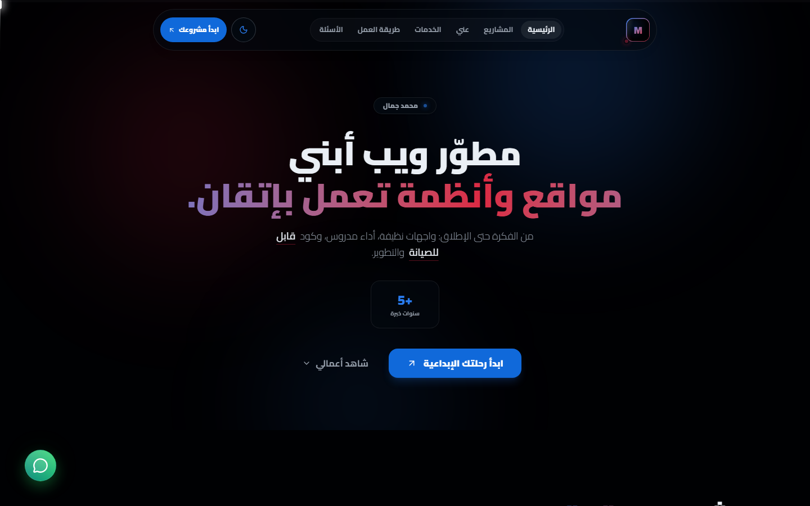
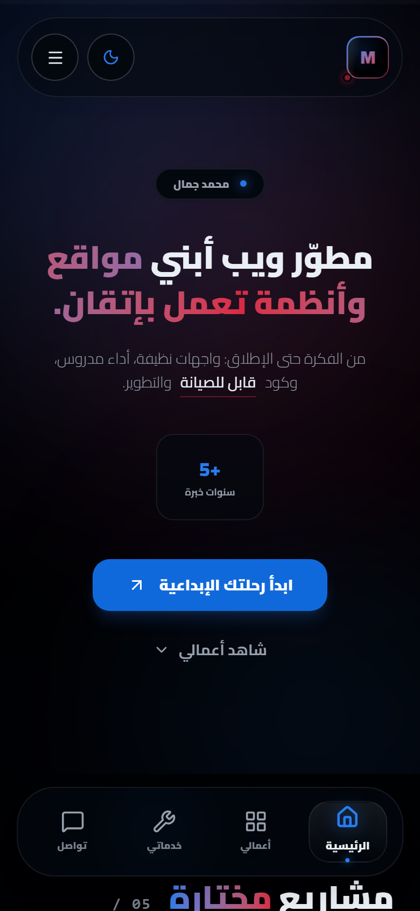

# Mohamed Gamal Portfolio

موقع بورتفوليو شخصي بالعربية (`RTL`) مبني بـ **Next.js 16 App Router** و**React 19** و**TypeScript** و**Tailwind CSS v4**، منشور على **Vercel**.

**Live Site:** https://www.mohamedjimmy.com

---

## Screenshots

|                Desktop (`1440×900`)                 |                Mobile (`390×844`)                 |
| :-------------------------------------------------: | :-----------------------------------------------: |
|  |  |

---

## Overview

- الصفحة الرئيسية (`/`) مبنية كـ **Static Prerender** وقت الـ build مع دعم كامل للغة العربية واتجاه `RTL` ووضعي الإضاءة الداكن والفاتح عبر `next-themes`.
- محتوى الأقسام الثابت (المشاريع، الخدمات، الخبرات، الأسئلة الشائعة، مراحل العمل) مُدار مركزيًا داخل `src/constants/`.
- يتضمن مسارات SEO قياسية (`/robots.txt`، `/sitemap.xml`، `/opengraph-image`، `/icon.svg`، `/apple-icon.png`) وبوابة نشر لمسارات دراسات الحالة (`/projects/[slug]`).
- نموذج التواصل يعمل عبر **Next.js Server Action** (`src/actions/contact.ts`) مع التحقق بـ **Zod** والإرسال عبر **Resend** وقالب **React Email**.

---

## Tech Stack

| Layer              | Technology                                                            |
| :----------------- | :-------------------------------------------------------------------- |
| Framework          | Next.js 16 (App Router)                                               |
| UI Library         | React 19                                                              |
| Language           | TypeScript 5 (`strict`)                                               |
| Styling            | Tailwind CSS v4 (`@theme` + OKLCH CSS variables)                      |
| Animation & Scroll | Framer Motion, Lenis                                                  |
| Icons & Utilities  | `lucide-react`, `next-themes`, `clsx`, `tailwind-merge`               |
| Email & Validation | Resend, React Email, Zod                                              |
| Testing & Quality  | Playwright (E2E + Visual Regression), Lighthouse CI, ESLint, Prettier |
| Hosting            | Vercel                                                                |

---

## Getting Started

### Requirements

- **Node.js** `20.9+` (CI runs on Node `22`)
- **npm** `10+`

### Installation

```bash
git clone https://github.com/momhamedga/mojimmy-portfolio.git
cd mojimmy-portfolio
npm ci
cp .env.example .env.local
```

ثم شغّل خادم التطوير:

```bash
npm run dev
```

---

## Environment Variables

| Variable         |      Required      | Description                                                                                                                         |
| :--------------- | :----------------: | :---------------------------------------------------------------------------------------------------------------------------------- |
| `RESEND_API_KEY` | For email delivery | مفتاح Resend المستخدم في `src/actions/contact.ts`. متغيّر خادمي فقط (بدون `NEXT_PUBLIC_`). القالب في [`.env.example`](.env.example). |

بدون `RESEND_API_KEY` يعمل الموقع والبناء (`next build`) بشكل طبيعي، ويرجع إرسال نموذج التواصل برسالة خطأ عامة فقط دون كشف تفاصيل الإعداد.

---

## Scripts

```bash
npm run dev                   # خادم التطوير المحلي
npm run build                 # بناء الإنتاج (Turbopack + فحص TypeScript)
npm run start                 # تشغيل نسخة الإنتاج محليًا
npm run lint                  # فحص ESLint
npm run lint:fix              # إصلاح تلقائي لمشكلات ESLint
npm run type-check            # فحص الأنواع (tsc --noEmit)
npm run format                # تنسيق الكود بـ Prettier
npm run format:check          # التحقق من التنسيق بـ Prettier
npm run clean                 # حذف مجلد .next
npm run test:e2e              # اختبارات Playwright على Chromium
npm run test:e2e:ui           # واجهة Playwright التفاعلية
npm run test:e2e:cross-browser # فحص التوافق على Firefox
npm run test:e2e:visual       # اختبارات الانحدار البصري (مخصصة لمرجع Linux)
```

---

## Running Tests

ثبّت متصفح Chromium لـ Playwright مرة واحدة:

```bash
npx playwright install chromium
```

لتشغيل سويت E2E محليًا دون لمس مزوّد البريد الحقيقي:

```bash
npx playwright test --project=chromium --grep-invert "@provider"
```

- يقوم [`playwright.config.ts`](playwright.config.ts) ببناء وتشغيل نسخة الإنتاج محليًا على منفذ `3100` مع تمرير مفتاح `RESEND_API_KEY` غير صالح عمدًا لعزل الاختبارات ومنع إرسال رسائل فعلية.
- اختبارات `@visual` تقارَن بمراجع Linux الملتزمة داخل [`tests/e2e/visual.spec.ts-snapshots`](tests/e2e/visual.spec.ts-snapshots) وتعمل في الـ CI داخل حاوية Playwright المثبّتة.

---

## CI & Automation

يعمل مسار CI في [`.github/workflows/ci.yml`](.github/workflows/ci.yml) على كل `pull_request` و`push` إلى `main`:

- **Quality:** `npm ci`، `npm run build`، `npm run type-check`، `npm run lint`، `npm run format:check`، و`npm audit --audit-level=high`.
- **E2E Chromium (local):** تشغيل سويت Playwright الوظيفية (`--grep-invert "@provider"`).
- **E2E Firefox smoke (local):** يعمل عند الدفع إلى `main` أو التشغيل اليدوي.
- **Visual regression:** مقارنة لقطات الواجهة مع المراجع المعتمدة داخل حاوية Playwright Linux المثبّتة بالـ digest.
- **Lighthouse CI (mobile):** فحص الأداء وسهولة الوصول وأفضل الممارسات وSEO على `/` عبر [`lighthouserc.json`](lighthouserc.json) بحد أدنى `0.90`.
- **Dependabot:** تحديثات أسبوعية لحزم `npm` و`github-actions` عبر [`.github/dependabot.yml`](.github/dependabot.yml).

---

## Project Structure

```text
src/
├── actions/            Server Actions (contact.ts via Resend)
├── app/                App Router pages, layouts, metadata, and UI components
├── assets/             Static project preview images (.webp)
├── constants/          Site configuration, projects, services, and copy
├── emails/             React Email notification template
├── lib/                Shared helpers, case-study gate, and contact security
└── types/              Shared TypeScript types
tests/
└── e2e/                Playwright E2E, compatibility, smoke, and visual suites
```

---

## Security

- **Security Headers ([`next.config.ts`](next.config.ts)):** `Content-Security-Policy`, `X-Content-Type-Options: nosniff`, `Referrer-Policy: strict-origin-when-cross-origin`, `Permissions-Policy`, و`X-Frame-Options: DENY`.
- **Contact Form Protection ([`src/lib/contact-security.ts`](src/lib/contact-security.ts) & [`src/actions/contact.ts`](src/actions/contact.ts)):** التحقق الصارم بـ Zod وتطبيع المدخلات، حقل فخ (`contact_ref`)، حدّ المعدّل (`rate limiting`) ومنع الإرسال المكرر، تعقيم الترويسات ومحارف الاتجاه الثنائي (`bidi`)، مهلة انتظار للمزوّد مع مفتاح `Idempotency`، وفحص `Origin`/`Host` المدمج في Server Actions.
- **Client Isolation:** `RESEND_API_KEY` يُقرأ على الخادم فقط، جميع الروابط الخارجية تستخدم `rel="noopener noreferrer"`، ولا توجد سكربتات طرف ثالث أو `dangerouslySetInnerHTML`.
